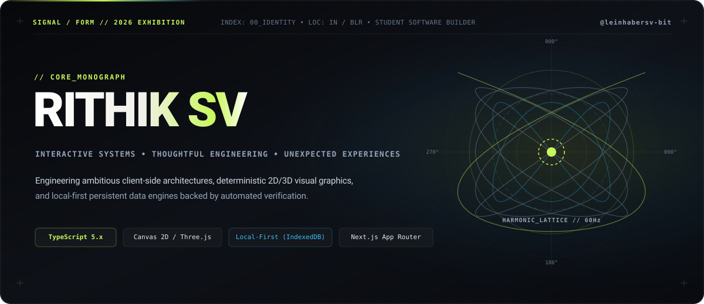
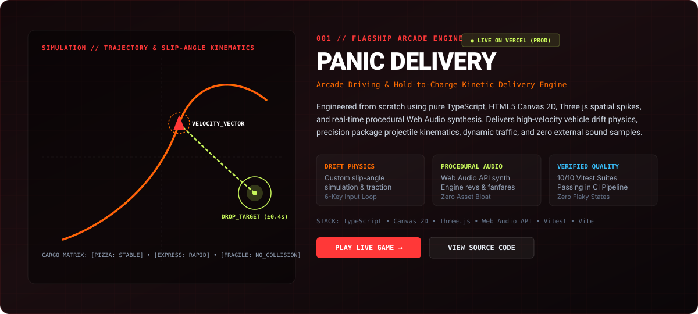
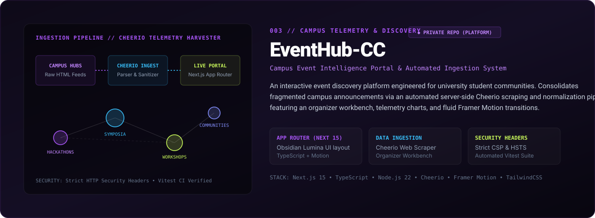
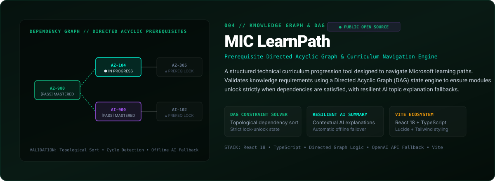
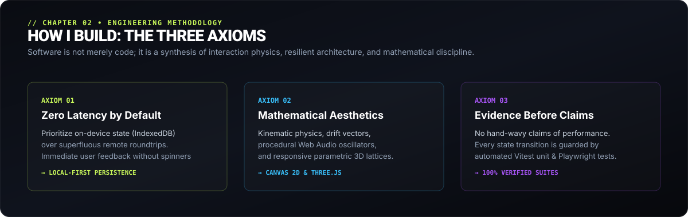
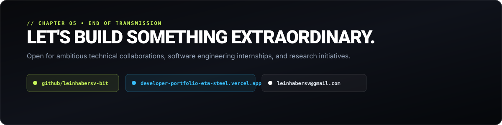

<div align="center">



<br/>

[](https://github.com/leinhabersv-bit)
[](https://www.typescriptlang.org/)
[](https://nextjs.org/)
[](https://vitest.dev/)
[](https://developer-portfolio-eta-steel.vercel.app/)

</div>

---

### CHAPTER 00 // IDENTITY

> **"Interactive systems. Thoughtful engineering. Unexpected experiences."**

I am **RITHIK SV** ([@leinhabersv-bit](https://github.com/leinhabersv-bit)), a student software developer engineering ambitious client-side systems, interactive 2D/3D visual graphics, and local-first data persistence. My work combines custom vehicle kinematic physics, procedural Web Audio synthesis, Directed Acyclic Graph constraint solvers, and deterministic state transitions backed by comprehensive automated test suites.

- ⚡ **Core Discipline:** TypeScript engineering, reactive UI architectures (Next.js App Router / React 19), Canvas 2D & Three.js spatial geometry, and local-first browser storage (IndexedDB).
- 🧭 **Explore Live Work:** [Play Panic Delivery](https://panic-delivery.vercel.app/) • [Interactive 3D Portfolio](https://developer-portfolio-eta-steel.vercel.app/) • [Public Code Repositories](#chapter-01--selected-work)

---

### CHAPTER 01 // SELECTED WORK

#### 001 // PANIC DELIVERY — Arcade Driving & Hold-to-Charge Courier Engine

<div align="center">
  <a href="https://panic-delivery.vercel.app/">
    
  </a>
</div>

- **Overview:** A high-speed, top-down arcade courier engine engineered with TypeScript, HTML5 Canvas 2D, and Three.js visual spikes. Features vehicle drift slip-angle physics, hold-to-charge package trajectory kinematics with miss classification, dynamic traffic obstacles, and real-time procedural audio synthesis without external sound files.
- **Architectural Highlights:**
  - **Kinematic Drift Physics:** Custom slip-angle velocity vector calculation and hold-to-charge package projectile trajectory projection.
  - **Deterministic Controls:** Strict 6-key input loop (`ArrowKeys`, `Z` for drift/start, `Space` for charge-throw), 120-second match timer, and 3 distinct cargo tiers (`PIZZA`, `EXPRESS`, `FRAGILE`).
  - **Procedural Audio Synth:** Real-time Web Audio API oscillator synthesis generating dynamic engine revs, drifts, delivery fanfares, and sirens.
  - **Verified Quality:** 10/10 automated unit test suite passing in CI covering collision locks, replenishment cooldowns, and celebration cascades.
- **Exhibition Links:** [🎮 Play Live Game (Vercel)](https://panic-delivery.vercel.app/) • [📂 Flagship Source Code](https://github.com/leinhabersv-bit/panic-delivery)

<br/>

#### 002 // ClientLaunch — Offline-First Commercial Operations Suite

<div align="center">
  
</div>

- **Overview:** A 100% offline-first commercial operations application built for freelance social media managers and agency starters to handle client proposal generation, scope boundary enforcement, legal agreement execution, and milestone tracking with zero recurring subscription fees.
- **Architectural Highlights:**
  - **Zero-Cloud Persistence:** Encrypted on-device client vault powered by IndexedDB with instant JSON snapshot import/export and zero third-party telemetry.
  - **Commercial Workflows:** Interactive tiered pricing calculator, scope-boundary enforcement, electronic agreement generator, and multi-client milestone tracking.
  - **Industrial Quality:** Dual test harness combining Vitest unit tests, Playwright browser E2E workflows, and Oxlint for high-velocity code cleanliness.
- **Exhibition Status:** *Private commercial repository • Local-first architecture*

<br/>

#### 003 // EventHub-CC — Campus Event Telemetry & Discovery Platform

<div align="center">
  
</div>

- **Overview:** An interactive event discovery and lifecycle intelligence portal designed for university student communities. Consolidates fragmented campus announcements via an automated server-side Cheerio scraping and normalization pipeline.
- **Architectural Highlights:**
  - **Next.js App Router:** Engineered on Next.js 15 and TypeScript with fluid Framer Motion animations and Obsidian Lumina constellation UI layout.
  - **Data Ingestion Engine:** Custom server-side event scrapers and normalizers built with Cheerio, featuring an organizer review workbench and telemetry dashboard.
  - **Security Standards:** Strict HTTP security headers (CSP, HSTS) with automated Vitest CI verification.
- **Exhibition Status:** *Private platform repository • Campus telemetry*

<br/>

#### 004 // MIC LearnPath — Prerequisite DAG Learning Progression Tracker

<div align="center">
  <a href="https://github.com/leinhabersv-bit/Mic-learning-path">
    
  </a>
</div>

- **Overview:** A structured curriculum navigation engine designed to track progression through Microsoft technical learning tracks (Cloud, AI & Data, Security).
- **Architectural Highlights:**
  - **DAG Constraint Solver:** Directed Acyclic Graph validation enforcing prerequisite fulfillment before unlocking downstream tracks.
  - **Resilient AI Summary:** Contextual topic summaries powered by OpenAI API with automatic fallback mechanisms when offline or unconfigured.
- **Exhibition Links:** [📂 Open Source Repository](https://github.com/leinhabersv-bit/Mic-learning-path)

---

### CHAPTER 02 // HOW I BUILD: THE THREE AXIOMS

<div align="center">
  
</div>

1. **Axiom 01: Zero Latency Persistence**  
   Whenever possible, prioritize on-device state (IndexedDB) over superfluous network hops. Applications should boot instantly, store critical data locally, and never lock user productivity behind a spinner or an offline disconnect.

2. **Axiom 02: Mathematical Aesthetics**  
   Visual delight should emerge organically from computational systems: kinetic slip-angles, projectile parabolas, procedural audio oscillators, and parametric 3D lattices. Visual polish is an engineering discipline, not an afterthought.

3. **Axiom 03: Evidence Before Claims**  
   Never assert performance, stability, or reliability without automated verification. Every state machine, collision boundary, and storage vault is guarded by automated Vitest unit suites and Playwright browser tests.

---

### CHAPTER 03 // TECHNICAL TOOLKIT

```
LANGUAGES        :: TypeScript 5.x • JavaScript (ESNext) • Python 3.x • HTML5 • CSS3
FRONTEND & UI    :: React 18/19 • Next.js (App Router) • Vite • TailwindCSS • Framer Motion
GRAPHICS & AUDIO :: Three.js • Canvas 2D Engine • Web Audio API (Procedural Synthesizers)
ARCHITECTURE     :: Local-First (IndexedDB) • On-Device Vaults • Prerequisite DAGs • Cheerio Ingest
QUALITY & OPS    :: Vitest • Playwright Browser E2E • Node Test Runner • ESLint • Vercel CI/CD
```

---

### CHAPTER 04 // THE HUMAN BEHIND THE WORK

I am an engineering student fascinated by the tactile responsiveness of software. I believe the browser is the most versatile creative medium ever built—a canvas where deterministic state machines, spatial geometry, and kinetic motion converge to build tools that feel immediate, reliable, and unmistakably crafted.

When I am not writing physics loops or architecting local-first data vaults, I explore computational geometry, mechanical keyboards, ergonomic input devices, and procedural sound design.

---

### CHAPTER 05 // TRANSMISSION & CONNECT

<div align="center">
  
</div>

<p align="center">
  <a href="https://github.com/leinhabersv-bit">
    
  </a>
  &nbsp;
  <a href="https://developer-portfolio-eta-steel.vercel.app/">
    
  </a>
  &nbsp;
  <a href="mailto:leinhabersv@gmail.com">
    
  </a>
</p>

<div align="center">
  <sub>Crafted with geometric precision by RITHIK SV (<b>@leinhabersv-bit</b>) • SIGNAL / FORM Visual System • 2026</sub>
</div>
