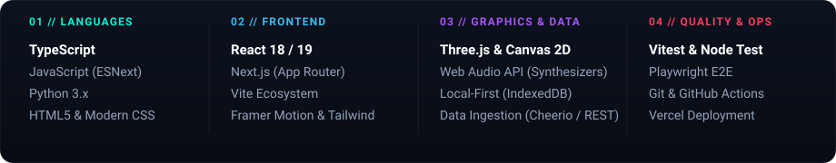
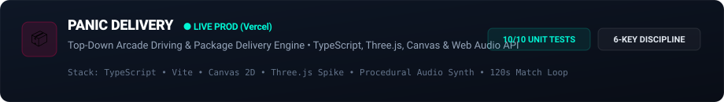
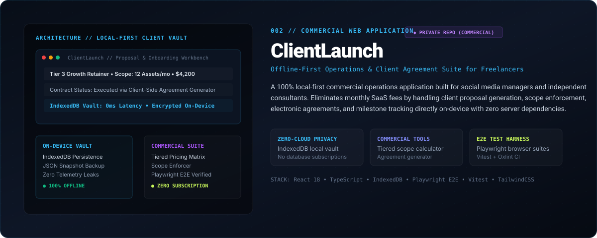

<div align="center">



<br/>

[](https://github.com/leinhabersv-bit)
[](https://www.typescriptlang.org/)
[](https://nextjs.org/)
[](https://vitest.dev/)
[](https://developer-portfolio-eta-steel.vercel.app/)

</div>

---

### 👨‍💻 About Rithik

I am a student software developer focused on building ambitious, interactive web applications and resilient client-side systems. My work bridges interactive 2D/3D graphics, local-first offline architectures, and rigorous testing methodologies. 

- 🔭 **Core Focus:** TypeScript engineering, reactive UI architectures (React/Next.js), 2D/3D Canvas rendering (Three.js), and local-first data persistence.
- ⚡ **Engineering Philosophy:** Fast load times, zero unnecessary server roundtrips, strict input discipline, and deterministic state transitions backed by automated test suites.
- 🌐 **Portfolio & Case Studies:** Live interactive demos deployed below. Explore my full portfolio and detailed case studies at https://developer-portfolio-eta-steel.vercel.app/.

---

### 🛠️ Technical Stack

<div align="center">
  
</div>

<br/>

| Domain | Core Technologies & Tooling |
| :--- | :--- |
| **Languages** | TypeScript, JavaScript (ESNext), Python 3.x, HTML5, CSS3 / Modern Layouts |
| **Frontend Frameworks** | React 18/19, Next.js (App Router), Vite, TailwindCSS, Framer Motion |
| **Graphics & Audio** | Three.js, HTML5 2D Canvas Engine, Web Audio API (Procedural Synthesizers) |
| **Architecture & Data** | Local-First Storage (IndexedDB), Client-Side Vaults, Prerequisite DAGs, Cheerio Ingestion |
| **Quality & Operations** | Vitest, Node Test Runner, Playwright E2E, Oxlint / ESLint, GitHub Actions, Vercel CI/CD |

---

### 🚀 Featured Engineering Case Studies

#### 1. [PANIC DELIVERY](https://github.com/leinhabersv-bit/panic-delivery) — Arcade Driving & Precision Courier Engine
<div align="center">
  <a href="https://github.com/leinhabersv-bit/panic-delivery">
    
  </a>
</div>

- **Overview:** A high-speed, top-down arcade delivery game engineered with TypeScript, HTML5 Canvas, and Three.js visual spikes. Features high-velocity vehicle drift physics, precision package-throwing kinematics with lock-on targeting, dynamic traffic obstacles, and procedural audio synthesis.
- **Key Technical Highlights:**
  - **Arcade Physics & Kinematics:** Custom drift slip-angle simulation and hold-to-charge package trajectory calculation with short/long/wide miss classification.
  - **Deterministic State Loop:** Strict 6-key input mapping (`Arrow Keys`, `Z` for drift/start, `Space` for charge-throw), 120-second match timer, and three distinct cargo varieties (`PIZZA`, `EXPRESS`, `FRAGILE`).
  - **Audio Synthesis:** Real-time procedural audio engine utilizing the Web Audio API for engine revs, drifts, delivery fanfares, and sirens without external audio assets.
  - **Verified Quality:** 10/10 automated unit test suite passing in CI covering collision locks, replenishment cooldowns, and celebration cascades.
- **Links:** [🎮 Play Live Game](https://panic-delivery.vercel.app/) • [📂 Source Code](https://github.com/leinhabersv-bit/panic-delivery)

<br/>

#### 2. ClientLaunch — Offline-First Commercial SMM Suite
<div align="center">
  
</div>

- **Overview:** A 100% offline-first commercial web suite built for freelance social media managers and agency starters to run proposal generation, contract execution, client onboarding, and campaign scheduling with zero subscription overhead.
- **Key Technical Highlights:**
  - **Local-First Data Architecture:** Fully persistent on-device operations powered by IndexedDB with automated JSON vault backup and restore — requiring no remote databases or third-party telemetry.
  - **Commercial Modules:** Interactive tiered pricing calculator, scope-boundary enforcement, electronic agreement generation, and multi-client milestone tracking.
  - **End-to-End Test Coverage:** Industrial-strength test harness combining Vitest unit tests, Playwright browser E2E workflows, and Oxlint for high-velocity code cleanliness.
- **Links:** [⚡ Live Product Showcase](https://clientlaunch.vercel.app) • *Private commercial repository*

<br/>

#### 3. EventHub-CC — Campus Event Telemetry & Discovery Platform
- **Overview:** An interactive event discovery and lifecycle intelligence portal designed for university student communities.
- **Key Technical Highlights:**
  - **Modern App Router:** Engineered on Next.js (Node 22) and TypeScript with fluid Framer Motion animations and Obsidian Lumina constellation UI layout.
  - **Ingestion Pipeline:** Custom server-side event scrapers and normalizers built with Cheerio, featuring an organizer review workbench and telemetry dashboard.
  - **Testing & Security:** Automated Vitest suite with strict HTTP security headers and automated deployment verification.
- **Links:** *Private platform repository*

<br/>

#### 4. [MIC LearnPath](https://github.com/leinhabersv-bit/Mic-learning-path) — Prerequisite DAG Learning Tracker
- **Overview:** A structured curriculum navigation tool designed to track progression through Microsoft technical learning tracks (Cloud, AI & Data, Security).
- **Key Technical Highlights:**
  - **DAG Prerequisite Engine:** Directed Acyclic Graph dependency validation ensuring modules unlock only when prerequisites are satisfied.
  - **Resilient AI Explanation Integration:** Contextual topic summaries powered by OpenAI API with automatic fallback mechanisms when offline or unconfigured.
- **Links:** [📂 Source Code](https://github.com/leinhabersv-bit/Mic-learning-path)

---

### 📊 Repository Architecture & Portfolio Focus

```
leinhabersv-bit/
├── 🎮 panic-delivery        # Public Flagship: TypeScript + Canvas + Three.js + Web Audio
├── ⚡ ClientLaunch          # Commercial Suite: Offline-First React + IndexedDB + Playwright
├── 🏛️ EventHub-CC           # Community Platform: Next.js + Motion + Ingestion Pipeline
└── 📚 Mic-learning-path     # Educational Tool: React + Prerequisite DAG + AI Integration
```

---

### 🌐 Portfolio

**[Explore my interactive developer portfolio →](https://developer-portfolio-eta-steel.vercel.app/)**

### 📫 Connect

<p align="left">
  <a href="https://github.com/leinhabersv-bit">
    
  </a>
  <a href="mailto:leinhabersv@gmail.com">
    
  </a>
</p>

---

<div align="center">
  <sub>Built with care &amp; precision by Rithik SV (<b>@leinhabersv-bit</b>). Crafted for performance, clarity, and resilience.</sub>
</div>
